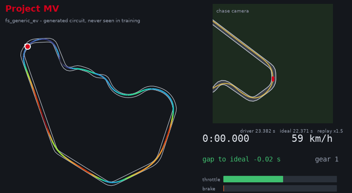

# Project MV

A racing driver made of software: car-agnostic, track-agnostic, learned by
reinforcement learning in a purpose-built GPU simulator, validated in Assetto
Corsa, and headed for a Formula Student Driverless car.

* **Any car** — a car is one YAML file (combustion, hybrid or electric).
* **Any track** — training uses endlessly regenerated random circuits; real
  circuits are only used for testing.
* **Nothing but racing** — the single objective is lap time within track limits.



**Watch laps in your browser:** the replay page (`docs/index.html`, published with GitHub Pages) - or locally in the control panel (`mvctl ui`, *Laps* tab).

**New here? Read [`docs/00-project-explained.md`](docs/00-project-explained.md)** - what the project is, how it works and what it has achieved, in plain language.

Start with [`docs/01-architecture.md`](docs/01-architecture.md). The running
diary of what was tried, what worked and what did not is
[`docs/engineering-log.md`](docs/engineering-log.md).

## Documentation

| Document | Content |
|---|---|
| [`docs/01-architecture.md`](docs/01-architecture.md) | How the system fits together; the three contracts (vehicle, track, observation) |
| [`docs/02-roadmap.md`](docs/02-roadmap.md) | Phases 0–6 with exit criteria, up to Formula Student Driverless |
| [`docs/03-decision-log.md`](docs/03-decision-log.md) | Every design decision with alternatives and reasons |
| [`docs/04-training-guide.md`](docs/04-training-guide.md) | How to train on the laptop GPU, what the numbers mean, troubleshooting |
| [`docs/engineering-log.md`](docs/engineering-log.md) | FS-style log: objective → approach → verification → problems → next steps |
| [`docs/07-assetto-corsa-bridge.md`](docs/07-assetto-corsa-bridge.md) | Connecting to the running game; setup and verification checklist |
| [`docs/08-reference-lap.md`](docs/08-reference-lap.md) | Physics reference lap (g-g-v diagram, racing line, speed profile) |
| [`docs/fs-rules-dv-summary.md`](docs/fs-rules-dv-summary.md) | Formula Student 2027 driverless rules digest with rule numbers |
| [`docs/vehicle-data-sources.md`](docs/vehicle-data-sources.md) | Where every number in `vehicles/library/` comes from |
| [`docs/glossary.md`](docs/glossary.md) | Plain-language explanations of every technical term used |

## Setup (Windows)

```powershell
cd "D:\Visual Studio\Project MV"
python -m venv .venv
.venv\Scripts\python.exe -m pip install torch --index-url https://download.pytorch.org/whl/cu126
.venv\Scripts\python.exe -m pip install numpy scipy pyyaml matplotlib pytest tensorboard
.venv\Scripts\python.exe -m pytest tests -q          # everything should pass
```

All commands below are run from the project root with `.venv\Scripts\python.exe`.

## Control panel and terminal command

**Desktop shortcut:** run `.venv\Scripts\python.exe scripts\make_desktop_shortcut.py` once; the "Project MV" icon then opens the control panel (starting it if needed, no terminal).

**Web interface** — `mvctl ui` (from the project folder; in PowerShell `.\mvctl ui`)
opens **http://127.0.0.1:8765**: live progress of every training, Pause / Resume,
the training plan (add, reorder, remove jobs), import of Assetto Corsa cars and
tracks, evaluation, vehicle checks, reference laps, and charts of every run. It
keeps running after the browser tab is closed; `mvctl ui-stop` stops it.
Training never depends on it.

**From your phone or another computer** — `mvctl remote` shows the same page on your
[Tailscale](https://tailscale.com) network at `https://<this-pc>.<your-tailnet>.ts.net/`
(HTTPS, reachable only by devices signed in to your Tailscale account; nothing is opened to
the internet). It uses `tailscale serve`, which forwards to the local panel - the panel itself
still listens on 127.0.0.1 only. The setting survives restarts; `mvctl remote-off` removes it.
The panel must be running on the laptop (desktop shortcut or `mvctl ui`). Its buttons work
remotely too, including Pause/Resume and "View in Assetto Corsa" (which starts the game on the
laptop).

**Terminal** — `mvctl status`, `mvctl watch` (live view with progress bars,
Ctrl+C to leave), `mvctl pause`, `mvctl resume`, `mvctl help`.

## Everyday commands

| I want to… | Command |
|---|---|
| Import a car from my Assetto Corsa | `scripts\import_ac_car.py ks_porsche_911_gt3_rs` (`--list porsche` to search; `--all` or `--category racing` for many - see "Car catalogue") |
| Import a circuit from my Assetto Corsa | `scripts\import_ac_track.py imola monza spa mugello` (`--list`) |
| Check a car's numbers against a road test | `scripts\vehicle_check.py ks_porsche_911_gt3_rs` |
| Measure simulator speed | `scripts\benchmark_env.py --envs 16384` |
| **Train** a driver | `scripts\train.py --vehicle ks_porsche_911_gt3_rs --name gt3rs_v1 --envs 16384 --tracks 512 --warm-start --hours 3` (see the training guide) |
| Continue a training run | same command plus `--resume` |
| **Pause / resume all training** (e.g. to take the laptop away) | double-click `pause_training.cmd` / `resume_training.cmd`; `status_training.cmd` shows progress (training guide §9) |
| Queue several trainings to run unattended | `scripts\queue_runs.py runs\queue_lane1.json` (see training guide §8) |
| Continue from a trained driver on new tracks | `scripts\train.py --vehicle ks_porsche_911_gt3_rs --name gt3rs_v2 --init-from runs\gt3rs_v1\latest.pt --preset mixed+gp` |
| Train **one driver for several cars** | `scripts\train.py --vehicle ks_porsche_911_gt3_rs,porsche_taycan_turbo_gt_weissach,ks_porsche_918_spyder --name multi_v1 --warm-start --hours 3` |
| Watch training curves | `.venv\Scripts\tensorboard.exe --logdir runs` |
| Time a trained driver + plots | `scripts\evaluate.py --vehicle ks_porsche_911_gt3_rs --policy runs\gt3rs_v1\best.pt --scripted` |
| Compute the physics reference lap | `scripts\reference_lap.py --vehicle ks_porsche_911_gt3_rs --track imola` |
| Check the link to the running game | `scripts\ac_bridge_check.py` |
| Tune a car to match the game (system identification) | record with `scripts\ac_drive.py ... --record x.npz`, then `scripts\sysid_fit.py --vehicle <car> x.npz` |
| Drive in the game | `scripts\ac_drive.py --vehicle ks_porsche_911_gt3_rs --track imola --scripted --dry-run` (then see its `--help`) |
| Show a lap in the game, with the ghost | control panel -> Laps -> Watch -> **View in Assetto Corsa**, or `scripts\ac_view.py --best ks_porsche_911_gt3_rs imola` (the button starts the game on the right circuit and car; setup: docs/07, "Viewing laps in the game") |
| Train on real circuits too (some always held out) | add `--real-tracks all` to `scripts\train.py` (which circuits: `tracks/sets.yaml`) |
| Train on many cars at once | `scripts\train.py --vehicle @favourites,@racing,-fs_generic_ev ...` (catalogue groups, see below) |
| Race a real F1 lap in equal machinery | `scripts\f1_benchmark.py` (fetch, align, fit the car), then `scripts\f1_benchmark.py --race runs\<run>\best.pt` - private data, never committed (D-038, log WP43) |
| Run the tests | `-m pytest tests -q` |
| Publish / update the private GitHub repo | `powershell -ExecutionPolicy Bypass -File scripts\publish_github.ps1` |

## Cars included

| File | Car | Source |
|---|---|---|
| `vehicles/local/ks_porsche_911_gt3_rs.yaml` | Porsche 911 GT3 RS (991), combustion, RWD | imported from your Assetto Corsa (create with `import_ac_car.py`) |
| `vehicles/local/ks_porsche_918_spyder.yaml` | Porsche 918 Spyder, hybrid, AWD | imported from your Assetto Corsa |
| `vehicles/library/porsche_taycan_turbo_gt_weissach.yaml` | Porsche Taycan Turbo GT Weissach, electric, AWD, 2-speed rear | public data |
| `vehicles/library/porsche_911_gt3_rs_992.yaml` | Porsche 911 GT3 RS (992) | public data |
| `vehicles/library/porsche_918_spyder.yaml` | Porsche 918 Spyder Weissach | public data |
| `vehicles/library/fs_generic_ev.yaml` | Generic Formula Student EV (typical class values, no real car) | estimates |

### Car catalogue and favourites

Every car installed in Assetto Corsa can be imported - one by one or all at once - and is sorted
into a category read from the game's own description of the car (`ui/ui_car.json`):
**formula** (single-seaters), **prototype** (LMP, Group C), **gt3**, **gt2_gte** (GT2/GTE/GT1),
**gt4**, **touring_cup** (touring, cup and other race cars) - together the *racing* cars - and
road, vintage, drift. The rules and a small table of exceptions are in `mv/vehicle/catalog.py`.

| I want to… | Command |
|---|---|
| Import every installed car | `scripts\import_ac_car.py --all` (~5-10 s per car, CPU only) |
| Import only racing cars / one category | `scripts\import_ac_car.py --category racing` (or `gt3`, `formula,prototype`, `favourites`) |
| See the catalogue table | `scripts\import_ac_car.py --table` |

Each imported car is checked: our power, mass and top speed against the figures the game
advertises for it, and a few seconds of full throttle and full braking in our simulator.
Cars come out *ok*, *suspicious* (usable, but a number is far off - the reason is shown) or
*failed*; empty DLC folders are reported as *not installed* and skipped. Results are kept in
`vehicles/local/_catalog.json` (git-ignored, like all game data).

**Favourites** are listed in `vehicles/favourites.yaml` (committed, car ids only). The control
panel shows them first, starred, wherever a car is picked (Plan, Tools, Import); all other cars
follow, folded under "Other cars (N)" and grouped by category. Click the star to add or remove
a favourite. The Import tab also has **Import all racing cars**. No IndyCar is installed in the
base game.

## Adding a new car

1. From Assetto Corsa: `scripts\import_ac_car.py <car_folder_name>` → `vehicles/local/<name>.yaml`.
   From data sheets: copy a file in `vehicles/library/`, edit the numbers; the
   schema with units is `mv/vehicle/params.py`.
2. `scripts\vehicle_check.py <name>` — do 0–100 km/h, top speed, braking and
   cornering grip look right?
3. Train or evaluate with `--vehicle <name>`. No code changes.

## Repository layout

```
mv/           the Python package
  vehicle/    car parameter schema + sanity summary
  track/      track format, random circuit generator
  sim/        batched vehicle physics
  envs/       the racing environment (sensors, reward, rules)
  rl/         PPO, warm start, evaluation
  control/    rule-based baseline driver
  planning/   physics reference lap
  ac/         Assetto Corsa: importers, live bridge, in-game driver
scripts/      command-line tools
tests/        automated tests
vehicles/     library/ (public data, committed)   local/ (from your AC install, git-ignored)
tracks/       local/ (from your AC install, git-ignored)
runs/         training output (git-ignored)
docs/         documentation
```

## License and ownership

Copyright © 2026 Edu Radu-Ștefan.

Project MV is free software, licensed under the **GNU Affero General Public
License v3.0 only** (AGPL-3.0-only) — see [`LICENSE`](LICENSE). In short: you
may use, study, modify and share it, but if you distribute a modified version
or run one as a network service, you must make its complete source code
available under the same license. For use under different terms (for example
in a closed-source or commercial product), contact the author for a separate
license.

Third-party libraries (PyTorch, NumPy, SciPy, PyYAML, Matplotlib) keep their
own licenses. Assetto Corsa car and track data are read from the user's own
installation and are deliberately **not** part of this repository
(`vehicles/local`, `tracks/local`, `.cache` are git-ignored) — they belong to
Kunos Simulazioni and must not be committed or shared.
