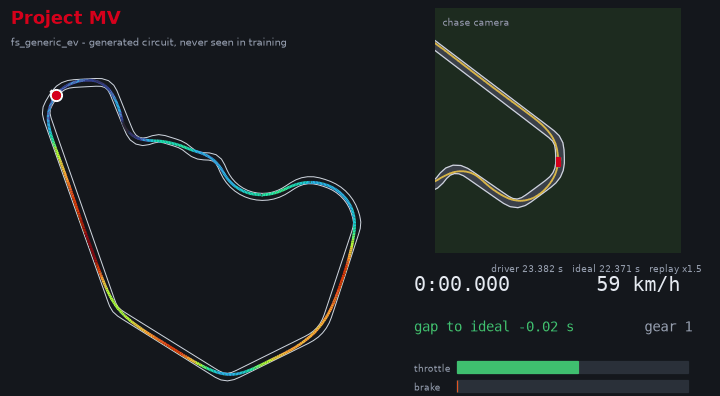

# Project MV — explained

*A plain-language account of what Project MV is, how it works and what it has
achieved so far (as of 18 November 2026). For details, every section points to
the technical document behind it.*

## 1. What it is, in one paragraph

Project MV is a **racing driver made of software**. It looks at the car and the
road ahead and decides, 25 times a second, how much to steer, accelerate and
brake. Nobody programs *how* to drive: it **learns by trial and error**
(reinforcement learning) in a simulator, over hundreds of millions of attempts.
The goal is pure racing — drive *any* car around *any* track as fast as physics
allows, staying within track limits. The end target is a Formula Student
driverless car; the first test bed is Assetto Corsa.

## 2. The four building blocks

| Block | What it does | Everyday analogy |
|---|---|---|
| **Car file** | Every number that defines a car: mass, power curve, gears, tyres, aerodynamics, brakes, battery. Combustion, hybrid and electric all fit the same format. | A car's spec sheet, but complete |
| **Simulator** | Our own physics engine that runs **thousands of cars at once** on the laptop's GPU: tyres, weight transfer, downforce, gearboxes, motors, battery. | A driving school with 16 000 cars driving simultaneously |
| **Track generator** | Invents a new random circuit whenever needed — straights, hairpins, chicanes, fast sweepers — at road-circuit or Formula Student scale. | A never-ending supply of unseen tracks |
| **The driver** | A neural network that learns from reward: *metres of progress per second*, minus a penalty for leaving the track. | The student |

Why our own simulator: Assetto Corsa runs one car in real time. Learning needs
around a billion decisions — months in the game, about one hour in ours.

## 3. What the driver sees

98 numbers, all things a real car could measure: its speed, sliding and
rotation; its pedals and steering; where it is between the track edges; the
shape of the road ahead (the tightest corner and narrowest point in each
stretch, up to 340 m ahead); a "lidar" that measures distance to the edges in 19
directions; and a short description of the car. Optionally: a memory of the
last second, and a memory of how the previous lap went at each part of the
track.

It never sees a whole-track map with its own position on it — so it cannot
memorise circuits. It has to *read the road*, like a human on an unknown track.

## 4. How we know the numbers are real

* **The physics was checked against real cars**: the simulated 911 GT3 RS does
  0–100 km/h in 3.3 s, 400 m in 11.1 s, brakes 100–0 km/h in 30 m and corners
  at ~1.2 g — matching published road tests.
* **A physics "perfect lap" for every car and track**: computed from the car's
  limits along the best racing line. The learned driver is measured against it.
  It can never beat it (and never has).
* **Strict laps only**: a lap counts only if the car stays on the track the
  whole way. (We found and retracted lap times that broke this rule — see §6.)
* **Every lap is recorded and replayable**: 25 samples per second of position,
  speed, steering, throttle, brake and gear, with a note of exactly which driver
  and training step produced it. Watch it in the control panel (Laps tab) next to
  the perfect lap, or download the raw data.
* **Real circuits are only ever used for testing**, never for training.
* **125 automated tests** check physics, sensors, lap timing and tools.

## 5. Results so far

Same car (911 GT3 RS), real circuits imported from Assetto Corsa, never seen in
training. "Ideal" = the physics-perfect lap.

| Circuit | Best learned driver | Physics ideal | Gap | Rule-based driver (for comparison) |
|---|---|---|---|---|
| Imola | 1:58.1 | 1:52.0 | +5.4 % | 2:27.6 |
| Red Bull Ring | 1:42.3 | 1:38.4 | +3.9 % | 1:59.5 |
| Monza | 2:02.9 | 1:57.9 | +4.3 % | 2:25.0 |
| Mugello | 2:08.5 | 2:02.7 | +4.8 % | 2:33.7 |
| Spa | 2:42.5 | 2:35.8 | +4.3 % | 3:18.2 |

* The learned driver completes **all 5 real circuits and 12 of 12 unseen
  generated circuits cleanly**, about **4–5 % off the physics ideal**, and
  20–30 % faster than a carefully hand-written rule-based driver.
* A Formula Student-style electric car (generic, public figures) driven by its
  own learned driver laps **8 of 8 generated FS circuits** cleanly, 1.7–4.4 %
  off the ideal on the published examples.
* Training speed on the laptop: ~150 000 driving decisions per second.

## 6. What went wrong along the way (and what we learned)

Recorded in full in the engineering log — the important ones:

1. **Cars spun at every heavy braking zone.** The first tyre model let a tyre
   lose almost all cornering grip when braking hard. Replaced with a proper
   "combined slip" model.
2. **The driver crashed at Monza and Imola at the same metre every lap**, for
   hours of training. Two training changes did not help. A close look showed
   the cause was its *eyesight*: the road-ahead sensor sampled points 20–45 m
   apart, and a short, tight chicane fell between them. Fixed by reporting the
   tightest corner in each stretch — the same driver then finished both circuits
   *without retraining*.
3. **"Limit-seeking" training** (go off, rejoin, try again) produced a faster
   driver, but our first evaluation counted laps where it had gone off and
   rejoined. Under the strict rule it completed only 2 of 5 real circuits. Those
   lap times were retracted; evaluation is now always strict.
4. **A driver trained on one car file cannot yet drive another** (0 of 6 with
   the public-data 992 GT3 RS). Training one driver on several cars at once is
   the fix and is in progress.

## 7. How it is operated

* `mvctl watch` — live progress bars in a terminal; `mvctl pause` / `resume`.
* `mvctl ui` — a control panel in the browser (http://127.0.0.1:8765):
  live training progress, the plan of training jobs, importing cars and tracks
  from Assetto Corsa, evaluations, and the **lap replay viewer**.
* Everything is documented in the style of a Formula Student design report:
  `docs/engineering-log.md` (what was tried, what worked, what failed),
  `docs/03-decision-log.md` (why each choice was made).

## 8. What comes next

1. One driver for several cars (in progress), then any car.
2. First drive inside Assetto Corsa (the connection is built and tested offline).
3. Tune the simulator to match Assetto Corsa from recorded laps (tool built).
4. Make the limit-seeking driver fast *and* clean.
5. Formula Student: cones, the official driverless missions, safety layer.

## 9. Ownership and license

Copyright © 2026 Edu Radu-Ștefan. The project is open source under the
**GNU AGPL-3.0** (see `LICENSE`): anyone may study and use it, but modified
versions — including ones offered as an online service — must be published
under the same license; other terms are available from the author. Assetto Corsa
data (car physics, circuit shapes) is read from the owner's own installation
and is never published; the published example laps use circuits generated by
the project and car files built from public figures.
